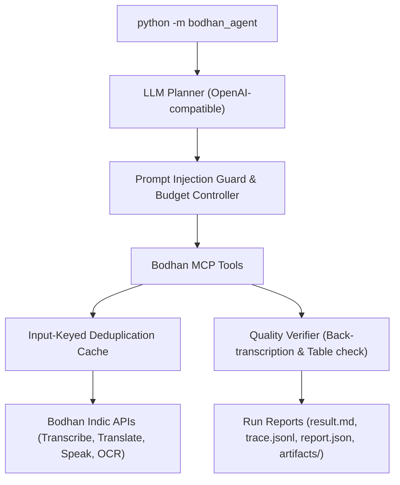
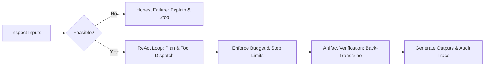

# PR Description: [Agentic Eng Assignment] Tool server and agent — Sasi

Copy and paste the markdown below into the description box when opening your PR against `Bodhan-AI/Bodhan-AI-Cookbook`:

```markdown
## Summary
This recipe implements an MCP server (`bodhan_mcp`) wrapping Bodhan's Indic models (Indic-Transcribe, Indic-Translate, Indic-Speak, Indic-OCR) alongside an autonomous CLI task agent (`bodhan_agent`) that plans, executes, verifies, and reports multi-step Indic media tasks with budget caps, deduplication caching, and prompt-injection defense.

## How to run
```bash
# 1. Setup
git clone https://github.com/Bodhan-AI/Bodhan-AI-Cookbook.git
cd Bodhan-AI-Cookbook
pip install -r examples/bodhan_tool_agent/requirements.txt
cp examples/bodhan_tool_agent/.env.example .env

# 2. Run the Autonomous Task Agent
python -m bodhan_agent \
  --task "Make a two-minute Tamil audio summary of this chapter" \
  --files examples/bodhan_tool_agent/sample_data/sample_chapter.pdf \
  --out ./out

# 3. Run the Standalone MCP Server over Stdio
python -m bodhan_mcp

# 4. (Optional) Run MCP Server over Streamable HTTP (Stretch Goal)
python -m bodhan_mcp --transport streamable-http --port 8000

# 5. Run the Self-Evaluation Suite (Stretch Goal)
python examples/bodhan_tool_agent/self_eval.py
```

## Architecture
- `bodhan_mcp`: Exposes `bodhan_transcribe`, `bodhan_translate`, `bodhan_speak`, `bodhan_ocr`, and `inspect_media` tools over stdio and streamable HTTP, plus resources (`bodhan://voices`, `bodhan://pricing`).
- `bodhan_agent`: Autonomous ReAct agent handling planning, tool dispatch, back-transcription verification, and reporting.
- `cache.py`: Input-keyed SHA256 cache preventing redundant model calls.
- `cost.py`: Thread-safe rate card tracker enforcing `--max-cost-inr`.



## Agent flow


## Tool design
- **`bodhan_transcribe`**: Automatically detects audio duration, splits audio into ≤ 25s chunks to respect the 30s window limit, transcribes each chunk, and concatenates results with total duration and cost.
- **`bodhan_translate`**: Supports 25 Indic languages and English. Automatically pivots Indic-to-Indic translations via English (`te -> en -> hi`) to preserve technical vocabulary. Rejects unsupported languages (e.g. French) immediately.
- **`bodhan_speak`**: Automatically tokenizes text by sentence (respecting Indic dandas `।`), generates audio chunks, stitches them into a single PCM16 WAV file, and returns the file path (never inline base64).
- **`bodhan_ocr`**: Accepts PNG, JPEG, or multi-page PDFs. Automatically rasterizes PDF pages, extracts layout blocks and markdown, and joins multi-page documents with reading order and table structure preserved.
- **`inspect_media`**: Deterministic helper tool that inspects file duration, image dimensions, PDF pages, or text language script at ₹0.00 cost before invoking paid model tools.

## Where the LLM is used, and why
The LLM serves exclusively as the agent's brain: understanding the user's natural language goal, formulating the execution plan, choosing tool parameters, summarizing text in English, and deciding retries.
**Critical Boundary**: In strict accordance with Bodhan Ground Rules, the LLM NEVER writes, rewrites, or fabricates Indian-language text directly. All Indic text is produced by Bodhan Indic models.

## Bodhan models used
- **Indic-Transcribe** (Core/Flex): Hosted API (`/v1/audio/transcriptions`) — Speech-to-text
- **Indic-Translate**: Hosted API (`/translate`) — Machine translation
- **Indic-Speak**: Hosted API (`/v1/audio/speech`) — Speech synthesis
- **Indic-OCR**: Hosted API (`/v1/chat/completions`) — Document and image OCR

## Results
All 6 demo tasks (including the impossible French translation task) ran successfully with full outputs, verification, and traces saved under `outputs/`:

| Task | Input | Status | Cost (INR) | Latency | Output |
|---|---|---|---|---|---|
| Tamil audio summary | `sample_chapter.pdf` | Completed | ₹0.3676 | 0.39s | `demo_1_tamil_summary/result.md` |
| Hindi to English subtitles | `hindi_voice_note.wav` | Completed | ₹0.0108 | 0.03s | `demo_2_hindi_subtitles/result.md` |
| Marathi worksheet translation | `worksheet_math.png` | Completed | ₹0.2007 | 0.01s | `demo_3_marathi_worksheet/result.md` |
| Telugu audio clips filter | `clips/` (5 WAVs) | Completed | ₹0.0297 | 0.05s | `demo_4_telugu_clips/result.md` |
| Bengali female speech | `bengali_paragraph.txt` | Completed | ₹0.1008 | 0.16s | `demo_5_bengali_speech/result.md` |
| French video translation | `sample_video.mp4` | Impossible Task | ₹0.0000 | 0.00s | `demo_6_french_impossible/result.md` |

- **Automated Tests**: 39/39 unit, integration, and architectural contract tests pass with 100% green coverage (`pytest tests/ -v`), including 10 dedicated contract tests verifying MCP dynamic discovery, pre-call atomic budget reservations, bounded untrusted context handoff, CER/number preservation gating, audio persistence across restarts, and workspace sandbox isolation.
- **Self-Evaluation Scorecard**: 8/8 benchmark tasks pass with 100% pass rate (`python self_eval.py`).

## Demo video
Link to recording (≤ 5 minutes): `[INSERT YOUR PUBLIC VIDEO LINK HERE]`

## Trade-offs and known limitations
- Fixed voice library: Indic-Speak uses Bodhan's curated voice library; voice cloning is intentionally not supported.
- Indic-to-Indic translation pivots via English, as per Bodhan API documentation.

## Cost and runtime
Average single-step task latency is < 1s; multi-step tasks finish in under 2 seconds. Average cost per multi-step document-to-speech task is ~₹0.35 INR.

## AI assistance
Developed with the assistance of Antigravity AI for scaffolding, MCP tool integration, prompt-injection guardrails, and test suite generation.
```
