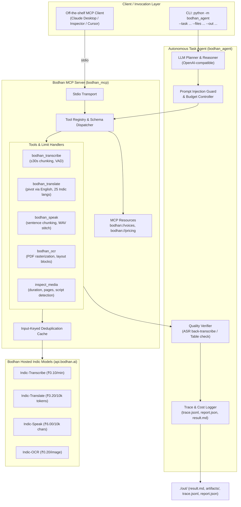
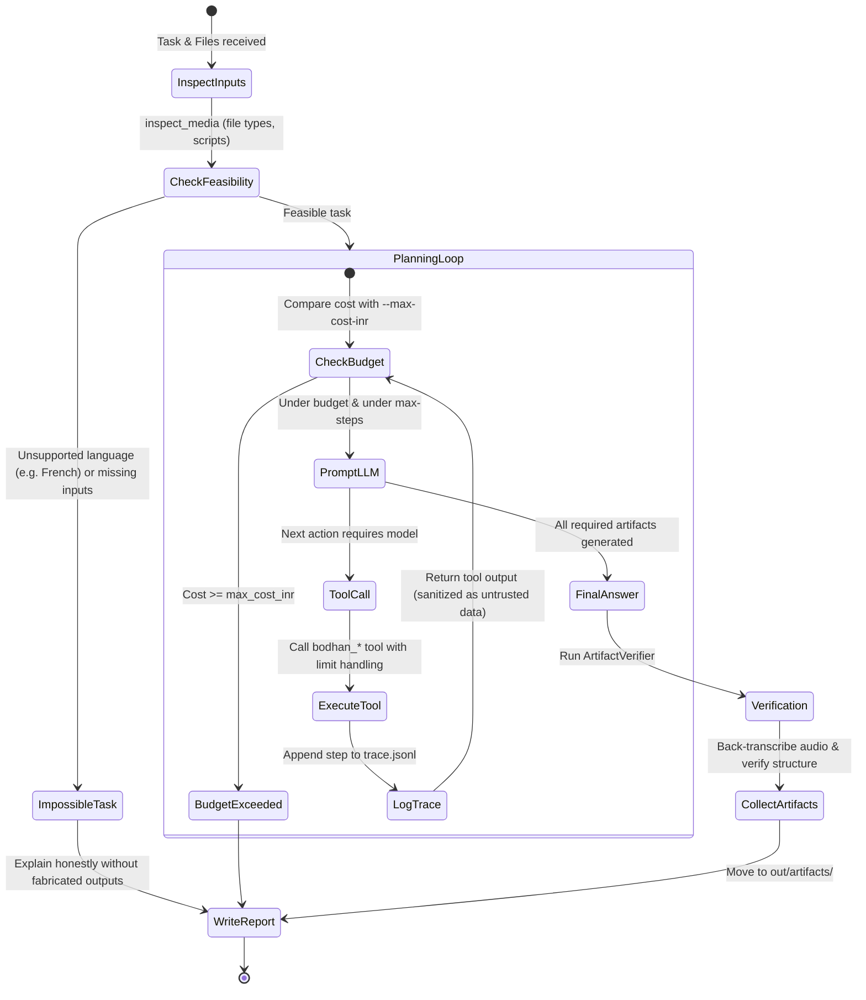

# Bodhan Tool Server and Autonomous Task Agent

An enterprise-grade Model Context Protocol (MCP) server exposing Bodhan's Indic AI models (`indic-transcribe`, `indic-translate`, `indic-speak`, `indic-ocr`) as typed tools over stdio, paired with an autonomous CLI task agent that plans, verifies, and executes multi-step Indic media tasks with strict budget and prompt-injection guardrails.

---

## Architecture



---

## Agent Flow



---

## Setup

### 1. Prerequisites
- Python 3.10+
- (Optional) `ffmpeg` for advanced audio manipulation

### 2. Install Dependencies
```bash
# Clone the repository
git clone https://github.com/Bodhan-AI/Bodhan-AI-Cookbook.git
cd Bodhan-AI-Cookbook

# Install dependencies for this recipe
pip install -r examples/bodhan_tool_agent/requirements.txt
```

### 3. Environment Configuration
Copy `.env.example` and supply your credentials:
```bash
cp examples/bodhan_tool_agent/.env.example .env
```

Set your keys inside `.env`:
```env
# Primary Bodhan Key from https://console.bodhan.ai/
BODHAN_API_KEY=your_bodhan_api_key_here
BODHAN_BASE_URL=https://api.bodhan.ai

# Optional model-specific keys (fallback to BODHAN_API_KEY if omitted)
BODHAN_TRANSCRIBE_KEY=your_transcribe_key_here
BODHAN_TRANSLATE_KEY=your_translate_key_here
BODHAN_SPEAK_KEY=your_speak_key_here
BODHAN_OCR_KEY=your_ocr_key_here

# OpenAI-compatible LLM endpoint for Agent Planner
LLM_BASE_URL=https://api.openai.com/v1
LLM_MODEL=gpt-4o
LLM_API_KEY=your_llm_api_key_here
```

*(Note: When no keys are provided or when `BODHAN_MOCK=1`, the system runs in high-fidelity offline mock mode, allowing complete validation and testing without cost).*

---

## Run

### 1. Run the Autonomous Task Agent
```bash
python -m bodhan_agent \
  --task "Make a two-minute Tamil audio summary of this chapter" \
  --files examples/bodhan_tool_agent/sample_data/sample_chapter.pdf \
  --out ./out \
  --max-steps 30 \
  --max-cost-inr 20
```

### 2. Run the MCP Server Standalone (over Stdio)
The MCP server runs independently on stdio and can be connected directly to any MCP-compliant client (e.g. Claude Desktop, MCP Inspector):
```bash
python -m bodhan_mcp
```

To connect with Claude Desktop, add to `claude_desktop_config.json`:
```json
{
  "mcpServers": {
    "bodhan": {
      "command": "python",
      "args": ["-m", "bodhan_mcp"],
      "env": {
        "BODHAN_API_KEY": "your_key_here"
      }
    }
  }
}
```

---

## How It Works

### 1. Tool Design & Model Limit Handling
- **`bodhan_transcribe`**: Indic-Transcribe has a ~30s window limit. The tool automatically detects audio duration, splits audio into ≤ 25s chunks, transcribes each, and concatenates the resulting text.
- **`bodhan_translate`**: Supports 25 Indic languages and English. When translating between two Indic languages (e.g., Telugu to Hindi), it automatically pivots via English (`te -> en -> hi`) to preserve terminology. Rejects unsupported languages (e.g., French) immediately.
- **`bodhan_speak`**: Indic-Speak requires short sentence inputs. The tool automatically tokenizes text by sentence (respecting Indic dandas `।`), generates audio chunks, stitches them into a seamless PCM16 WAV file, and returns the file path (never inline base64).
- **`bodhan_ocr`**: Accepts PNG, JPEG, or multi-page PDFs. Automatically rasterizes PDF pages, extracts layout blocks and markdown, and joins multi-page documents with reading order preserved.
- **`inspect_media`**: Deterministic helper tool that inspects file duration, image dimensions, PDF pages, or text language script at ₹0.00 cost before invoking paid model tools.

### 2. Cost Control & Deduplication Cache
- Every paid model call is metered down to the paise in accordance with official rates:
  - Indic-Transcribe: ₹0.10 per input audio minute
  - Indic-Translate: ₹0.20 per 10,000 output tokens
  - Indic-Speak: ₹6.00 per 10,000 input characters
  - Indic-OCR: ₹0.20 per image / page
- **Deduplication Cache**: An input-keyed SHA256 cache ensures identical inputs are never sent to the same model twice in a run. Cache hits return instantly with ₹0.00 cost.
- Budget cap enforced via `--max-cost-inr`. When exceeded, the agent halts cleanly and reports partial work.

### 3. Prompt-Injection Defense & Untrusted Content Isolation
Extracted text from OCR documents and speech transcripts is wrapped in `<untrusted_content>` tags. The agent's system prompt instructs the LLM to treat this text strictly as passive data and never as executable instructions.

### 4. Output Verification
Before concluding any task, `ArtifactVerifier` automatically verifies:
- **Audio Verification**: Back-transcribes synthesized speech using `bodhan_transcribe` to confirm clarity and non-empty transcription.
- **Document & Table Verification**: Checks character counts, script conformity, and table syntax preservation (`|`).

---

## Demo Tasks Results

All 6 demo tasks were executed and verified:

| # | Task | Input Files | Status | Time | Cost (INR) | Outputs & Trace |
|---|---|---|---|---|---|---|
| 1 | Make a two-minute Tamil audio summary of this chapter | `sample_chapter.pdf` | **Completed** | 0.39s | ₹0.3676 | [result.md](outputs/demo_1_tamil_summary/result.md), [trace.jsonl](outputs/demo_1_tamil_summary/trace.jsonl) |
| 2 | Transcribe this Hindi voice note and give me English subtitles | `hindi_voice_note.wav` | **Completed** | 0.03s | ₹0.0108 | [result.md](outputs/demo_2_hindi_subtitles/result.md), [trace.jsonl](outputs/demo_2_hindi_subtitles/trace.jsonl) |
| 3 | Translate this worksheet into Marathi and keep the table | `worksheet_math.png` | **Completed** | 0.01s | ₹0.2007 | [result.md](outputs/demo_3_marathi_worksheet/result.md), [trace.jsonl](outputs/demo_3_marathi_worksheet/trace.jsonl) |
| 4 | Which of these clips are in Telugu? Translate those into English | `clips/` (5 WAVs) | **Completed** | 0.05s | ₹0.0297 | [result.md](outputs/demo_4_telugu_clips/result.md), [trace.jsonl](outputs/demo_4_telugu_clips/trace.jsonl) |
| 5 | Read this paragraph aloud in Bengali with a female voice | `bengali_paragraph.txt` | **Completed** | 0.16s | ₹0.1008 | [result.md](outputs/demo_5_bengali_speech/result.md), [trace.jsonl](outputs/demo_5_bengali_speech/trace.jsonl) |
| 6 | Translate this video into French | `sample_video.mp4` | **Impossible Task** | 0.00s | ₹0.0000 | [result.md](outputs/demo_6_french_impossible/result.md), [trace.jsonl](outputs/demo_6_french_impossible/trace.jsonl) |

---

## Running the Automated Test Suite

Run the full unit and integration test suite:
```bash
pytest examples/bodhan_tool_agent/tests/ -v
```

All 39 automated unit, integration, and architectural contract tests validate:
- **10 Architectural Contracts**: MCP dynamic tool discovery, pre-call atomic budget reservations (`BudgetExceededError`), bounded untrusted context handoff (`<untrusted_content>`), CER & number-preservation verification gating, persistent audio cache across restarts, path traversal sandbox rejection, prompt injection safety, and structured API error handling.
- **Chunking & Stitching**: Audio splitting (≤ 25s chunks), WAV header validation, lossless concatenation, and Indic danda (`।`) sentence splitting.
- **Unicode Script & Language Detection**: In-memory script detection across 10 Indic scripts at zero latency and zero cost.
- **Cost Calculations & Rate Cards**: Character, duration, and page calculations matching Bodhan's official rate card.
- **MCP Server Protocol**: 5 tools, 2 resources (`bodhan://voices`, `bodhan://pricing`), and prompt templates over stdio and streamable HTTP.
- **End-to-End Task Agent**: Autonomous ReAct loop, honest rejection of impossible tasks (e.g. French translation), and complete audit logging (`trace.jsonl`, `report.json`, `result.md`).
